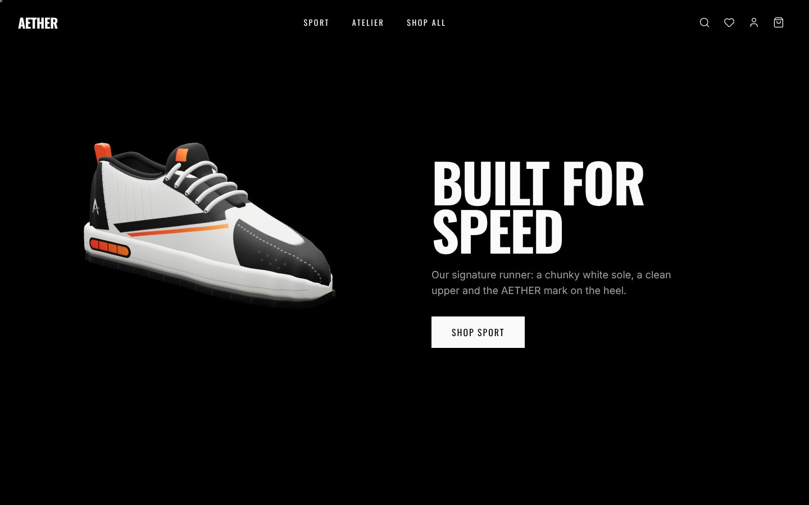
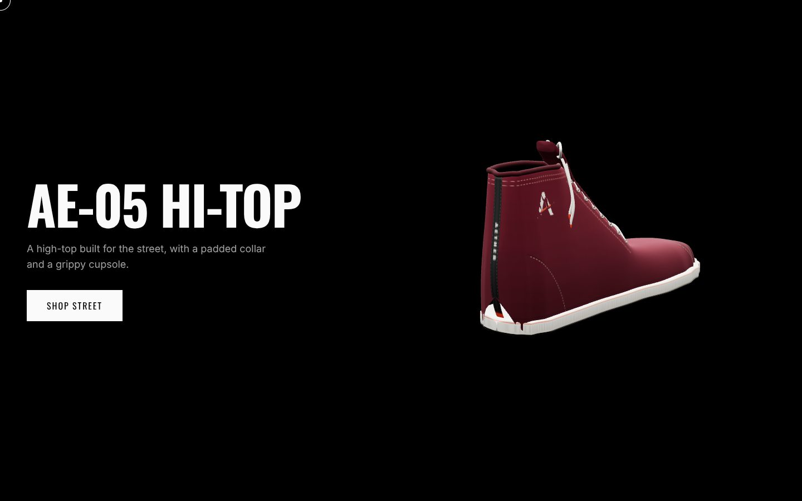
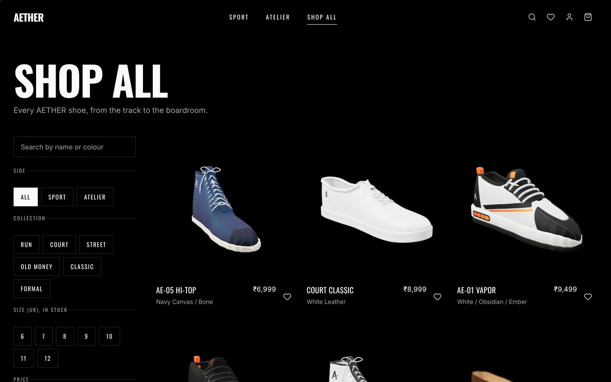
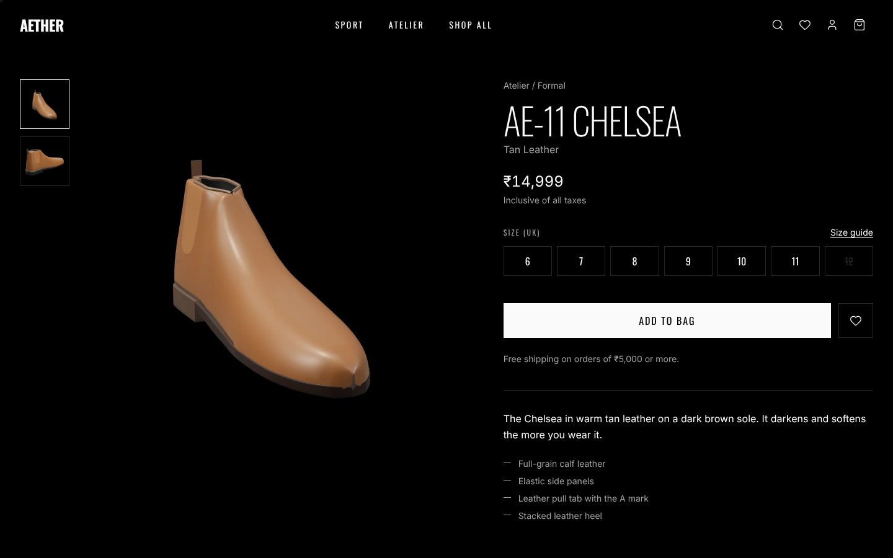
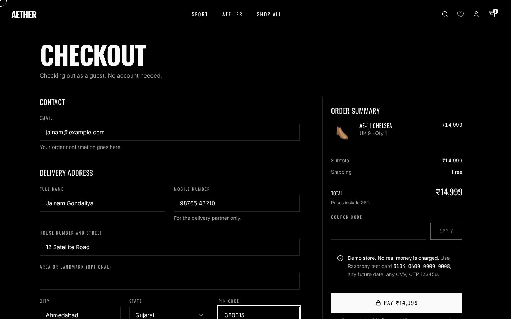
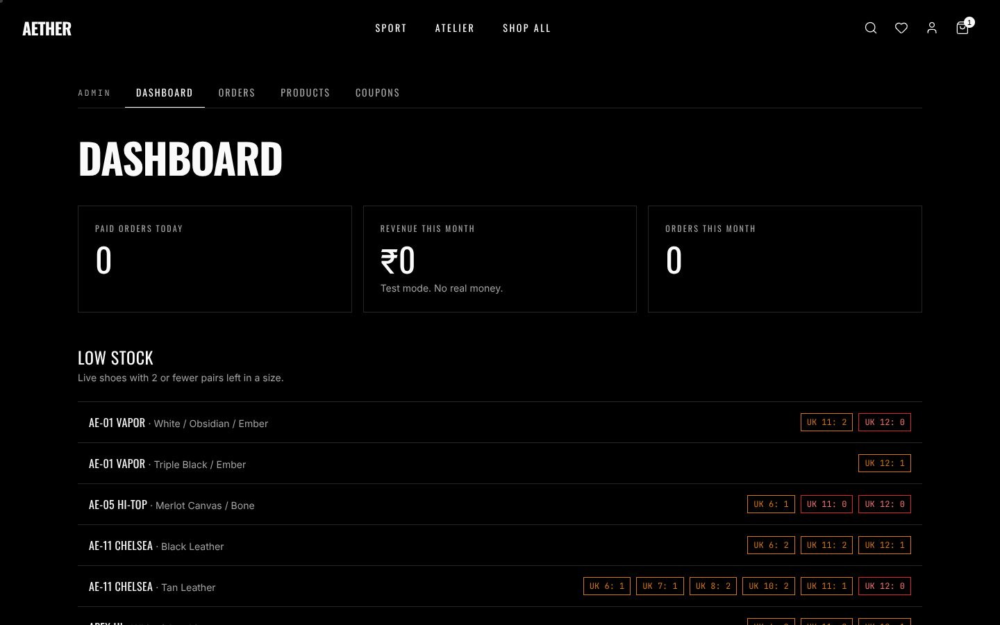

# AETHER

A premium footwear store, built end to end as a portfolio project. Two sides of one brand: **Sport** (running, court and street shoes) and **Atelier** (loafers, Chelsea boots and formal shoes). The home page has three scroll chapters, each with a 3D shoe that turns as you scroll.

**Live demo:** https://YOUR-PROJECT.vercel.app

> This is a demo store. Payments run in Razorpay **test mode**, so no real money moves and nothing ships.
> To try checkout, use test card **5104 0600 0000 0008**, any future expiry, any CVV, OTP **123456**.



| | |
|---|---|
|  |  |
|  |  |



## What it does

- **Shop:** search, filters (side, collection, UK size in stock, price), size guide, wishlist, bag that survives a refresh.
- **Checkout:** guest or account, Indian address validation, coupons, GST-inclusive prices, free shipping from ₹5,000.
- **Payments:** Razorpay, verified on the server. A confirmation email goes out through Resend.
- **After the sale:** order history for accounts, order tracking for guests (number + email), a Paid → Packed → Shipped → Delivered timeline.
- **Admin:** dashboard (today's orders, this month's revenue, low stock, refunds needed), products, stock per size, show/hide, orders and status changes, coupons.
- **Motion:** smooth scroll, scroll-driven 3D (React Three Fiber), page transitions, magnetic buttons. Reduced-motion users get still images and no smooth scrolling.

## Stack

Next.js 16 (App Router, JavaScript) · React 19 · Tailwind CSS 4 · MongoDB Atlas + Mongoose · Razorpay · Resend · zod · jose · bcrypt · zustand · three.js / React Three Fiber / drei · GSAP · Lenis · Motion · Vitest · Playwright · Vercel

## How payments are kept honest

The browser never decides a price. It sends only product IDs, sizes and quantities.

1. **Checkout:** the server reloads every product from the database, re-prices the bag, applies the coupon and shipping rules, and creates the Razorpay order for that exact amount. Quantity above 5, a sold-out size or an edited price all fail here.
2. **Confirmation:** after the Razorpay popup, the server checks Razorpay's HMAC-SHA256 signature with the secret key, using a constant-time comparison. A forged or reused signature is rejected.
3. **Webhook backup:** Razorpay also calls the server directly, with its own signature. If the customer closes the tab right after paying, the order still gets confirmed.
4. **Exactly once:** an order moves from `pending` to `paid` in one atomic database update, so the popup, a page refresh and the webhook can all arrive together and stock still drops once, with one email.
5. **The last pair:** stock comes off only if enough is left, in the same update. If two people pay for the last pair at the same moment, one gets it and the other order is flagged **Refund needed** in admin.

## Security

- Passwords hashed with bcrypt (cost 12). Sessions are signed, httpOnly, SameSite cookies.
- Every admin page **and every admin server action** checks the role from the database. Hiding the admin pages isn't the protection.
- Rate limits on sign-in, registration, coupon tries, checkout and order tracking.
- Same-origin checks on every write request.
- Order pages open only for the browser that placed the order or the account that owns it. Tracking needs number + email and answers "not found" the same way either way.
- Security headers: Content-Security-Policy, HSTS, X-Frame-Options, nosniff, Referrer-Policy, Permissions-Policy.
- Known trade-off: the CSP allows `'unsafe-inline'` scripts. The stricter nonce approach would force every page to render on each request and lose static caching. Everything else is locked to this site and Razorpay.

## Run it locally

```bash
npm install
cp .env.example .env.local   # then fill in your own values
npm run seed                 # 12 shoes, 2 coupons, 1 admin account
npm run dev
```

Environment variables (`.env.local`, never committed):

| Name | What it is |
|---|---|
| `MONGODB_URI` | MongoDB Atlas connection string |
| `SESSION_SECRET` | 32+ random characters for signing sessions |
| `RAZORPAY_KEY_ID`, `NEXT_PUBLIC_RAZORPAY_KEY_ID` | Razorpay **test** key id (`rzp_test_…`) |
| `RAZORPAY_KEY_SECRET` | Razorpay test key secret |
| `RAZORPAY_WEBHOOK_SECRET` | The secret you set on the Razorpay webhook |
| `RESEND_API_KEY` | Resend API key for confirmation emails |
| `EMAIL_FROM` | Optional sender, e.g. `AETHER <orders@yourdomain.com>` |
| `NEXT_PUBLIC_SITE_URL` | `http://localhost:3000` locally, your live URL in production |
| `ADMIN_EMAIL`, `ADMIN_PASSWORD` | Used once by `npm run seed` to create the admin |

Tests: `npm test` (160 tests across pricing, coupons, auth, checkout, payment verification, fulfilment, tracking and admin, run against a real MongoDB).

## Credits

Designed and built by **Jainam Gondaliya**. The 3D shoe models were designed for AETHER. Product photos are AI-generated studio shots. AETHER is an invented brand.
